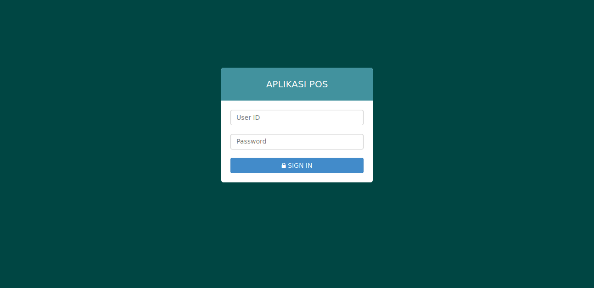

# POS Java Turtle Resto & Cafe

    

> Sistem POS berbasis web untuk operasional restoran atau kafe dari transaksi sampai pengelolaan stok.

## Preview



*Screenshot halaman login yang sudah tersedia di repository. Tidak menampilkan transaksi, akun, atau mengakses database produksi.*

## Tentang proyek

Sistem POS berbasis web untuk operasional restoran atau kafe dari transaksi sampai pengelolaan stok. Dokumentasi ini dibuat sebagai panduan singkat untuk memahami ruang lingkup proyek, menjalankannya secara lokal, dan membaca batasan penggunaannya.

## Fitur utama

- Invoice dan struk thermal 80 mm
- QRIS dinamis dengan timer kedaluwarsa
- Stok real-time
- Sinkronisasi Google Apps Script
- CSRF dan role admin/kasir
- Tema gelap dan terang

## Teknologi

- PHP
- MySQL
- Google Apps Script
- JavaScript
- QRIS

## Menjalankan secara lokal

Prasyarat dan konfigurasi dapat berbeda menurut sistem operasi. Contoh langkah utama:

```bash
Salin ke web server PHP, buat database dari SQL yang tersedia, lalu sesuaikan koneksi database lokal.
```

## Struktur dan pengembangan

Mulai dari entry point dan folder konfigurasi proyek. Pisahkan credential lokal dari source code, tambahkan test untuk perubahan penting, dan gunakan environment variable untuk konfigurasi deployment.

## Keamanan

- Jangan commit API key, password, token, session ID, atau data pribadi.
- Gunakan file environment lokal dan contoh konfigurasi tanpa nilai rahasia.
- Uji perubahan pada environment development sebelum deployment.

## Status

Proyek ini merupakan bagian dari portofolio **Hilman Arifin Ilham** dan dapat dikembangkan sesuai kebutuhan penggunaan.

> **Catatan:** Sebelum deployment, ganti seluruh credential database, webhook, dan konfigurasi pembayaran dengan nilai milik lingkungan deployment.

## Lisensi

Belum ada lisensi open-source yang dinyatakan di repository ini. Hubungi pemilik repository sebelum menggunakan ulang atau mendistribusikan kode.

---

Dibuat oleh [Hilman Arifin Ilham](https://github.com/hilman-devop).
